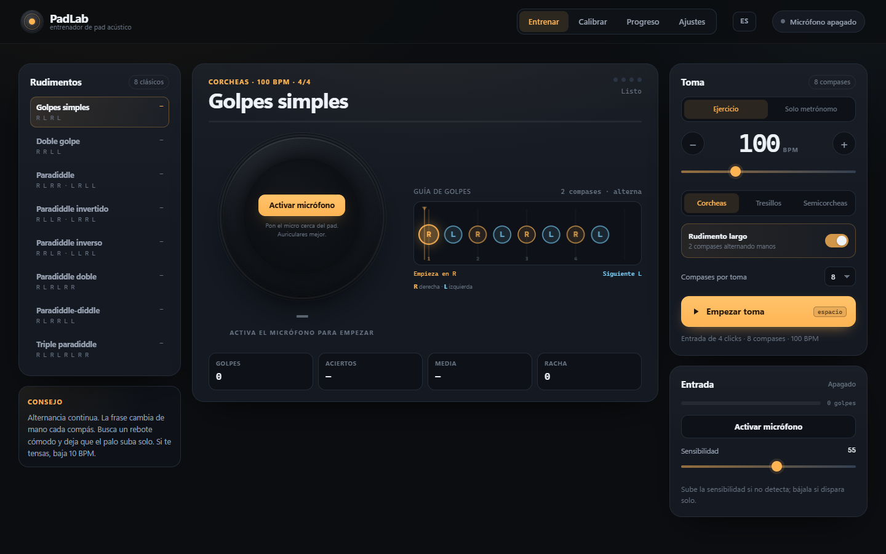
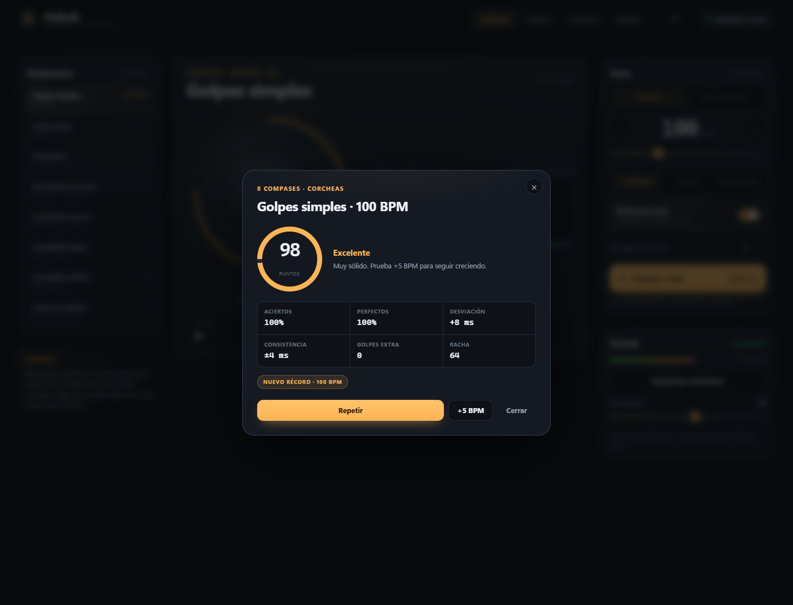
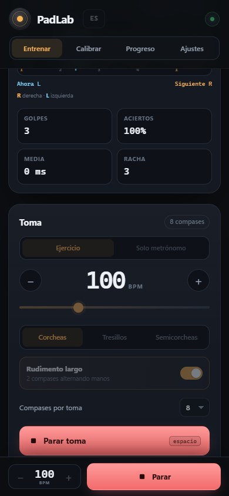
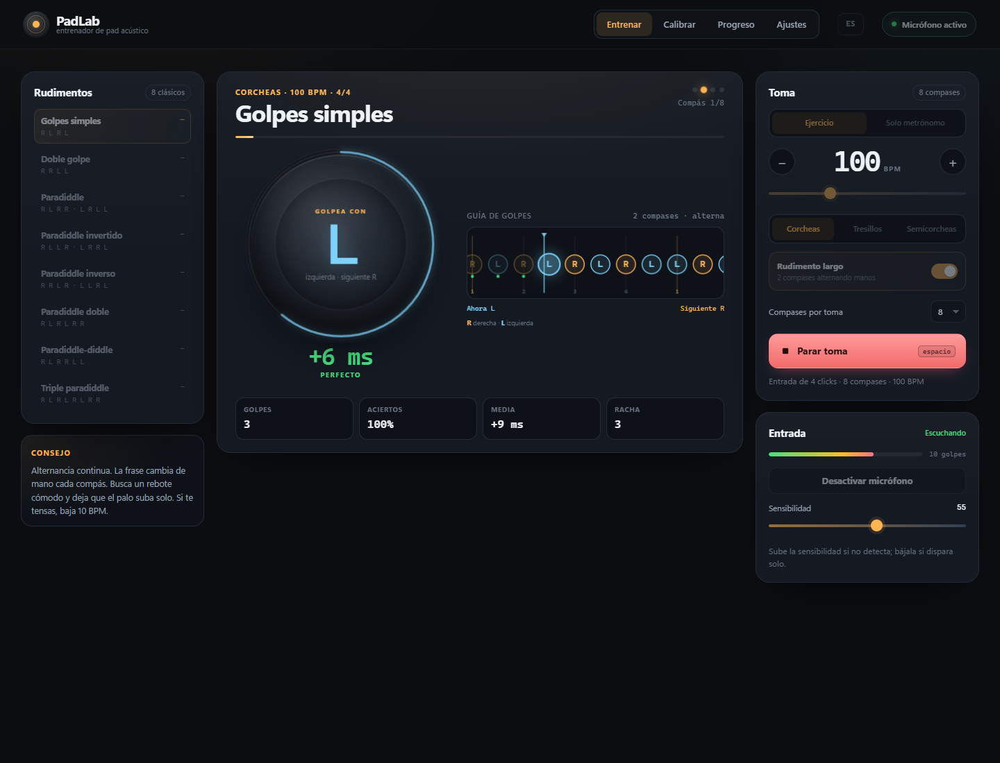
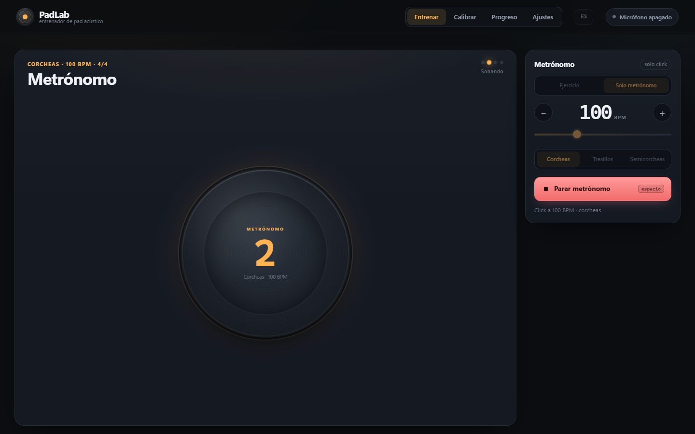

# PadLab

Entrenador de pad acústico para el navegador. Escucha tu pad por el micrófono, pone el metrónomo y te dice, golpe a golpe, cuánto te has desviado del pulso.



## Qué es

PadLab está pensado para practicar con un **pad acústico real**, no con un pad en pantalla:

- Detecta los golpes con el micrófono y los marca en el reloj de audio.
- Compara cada golpe con la rejilla del metrónomo y muestra el error en milisegundos.
- Clasifica el resultado: perfecto (±20 ms), bien (±40 ms), pronto o tarde.
- Guía visual con línea temporal, cabezal y la mano **R/L** en grande dentro del pad.
- Interfaz en **español, inglés y francés** (selector en la cabecera y en Ajustes).
- **8 rudimentos clásicos**, con corcheas, tresillos y semicorcheas.
- Frases de 2 compases que alternan la mano inicial y tomas de 2 a 32 compases.
- **Modo solo metrónomo**, sin micrófono ni análisis.
- Guarda tus tomas, récords y racha de días en el propio navegador.

Sin cuentas, sin servidor y sin enviar audio a ningún sitio. Todo ocurre en local.

La vista de entrenamiento cabe **en una sola pantalla, sin scroll**, desde 1024 × 600 px en escritorio hasta un móvil de 360 × 640 px. En escritorio se ven las tres columnas (rudimentos, mesa y toma) a la altura de la ventana. En móvil y tablet queda solo la mesa: el pad, la guía de golpes, el resumen y la barra inferior con el tempo y **Empezar/Parar**. Los rudimentos se abren con **Cambiar** y los ajustes de la toma con el botón de la barra inferior, en hojas que suben desde abajo.

| Resumen de una toma | Vista móvil |
| --- | --- |
|  |  |

## Guía de golpes

Durante la toma, el pad muestra en grande la mano que toca (`R` derecha, `L` izquierda) y debajo tienes la línea temporal: las notas se acercan a un cabezal fijo, que marca el instante del golpe. Las notas ya tocadas dejan un punto verde o ámbar según su precisión.



La frase puede ser de **1 compás** o de **2 compases alternando la mano inicial** (R espeja a L). La toma se puede alargar hasta **32 compases**, así que no tienes por qué cortar el rudimento cada pocos segundos.

La antigua gráfica de dispersión respecto al pulso se ha quitado: el resumen de la toma y la guía de golpes dan la información sin ocupar media pantalla.

## Solo metrónomo

El selector **Ejercicio / Solo metrónomo** está en el panel de la toma. En modo metrónomo:

- No hace falta activar el micrófono.
- Suena el click con el BPM y la subdivisión elegidos.
- El pad muestra el pulso (1–4) y los puntos de compás.
- No hay análisis ni resumen: solo metrónomo.
- Se para con el mismo botón, con `Espacio` o con `Esc`.



## Arrancarlo

Requisitos: Node.js 18 o superior (solo para el servidor estático; la app no tiene dependencias).

```bash
cd padlab
node server.mjs
```

Abre <http://localhost:8123>. También puedes usar `python -m http.server 8123` o cualquier servidor estático.

> El micrófono solo está disponible en **HTTPS** o en **localhost**. Si abres la app desde el móvil usando `http://192.168.x.x:8123`, la interfaz se ve pero el navegador bloqueará el micrófono. El modo solo metrónomo funciona igual por HTTP, sin micro.

### Probarla en el móvil

La app es estática: no hay que compilar nada. Para usarla en el teléfono tienes dos caminos:

1. **Publicarla** en Netlify Drop, Vercel, Cloudflare Pages o GitHub Pages subiendo `index.html`, `styles.css`, `src/` y `favicon.svg`. Te dará una URL HTTPS y el micrófono funcionará.
2. **Túnel HTTPS** hacia el servidor local, por ejemplo con `cloudflared tunnel --url http://localhost:8123` o `ngrok http 8123`.

`node server.mjs --host` sirve la interfaz en la red local para probar el diseño, pero el micrófono seguirá bloqueado por HTTP. Es útil solo para maquetación.

## Cómo se usa

1. Elige **Ejercicio** o **Solo metrónomo**.
2. En ejercicio, pulsa **Activar micrófono** y acepta el permiso. Verás el medidor y el contador de golpes.
3. Golpea el pad para comprobar que te oye. Si no detecta, sube la **sensibilidad**; si dispara solo, bájala.
4. Entra en **Calibrar** y toca 12 clicks seguidos. Aplica el retardo medido. Sin este paso la app funciona, pero el análisis será menos fino.
5. Elige rudimento, densidad, frase, compases y BPM.
6. Pulsa **Empezar toma**. Hay una entrada de 4 clicks y empieza la toma.
7. Al terminar verás aciertos, perfectos, desviación media, consistencia y puntos. Si has ido bien, prueba **+5 BPM**.

Consejos:

- Usa **auriculares** para el click. Si suena por altavoces, el micrófono puede confundir el click con un golpe.
- Acerca el micro al pad, pero no lo tapes.
- Empieza cómodo. Es mejor 80 BPM limpios que 120 BPM a trompicones.

## Rudimentos incluidos

| Rudimento | Base | Densidades | BPM inicial |
| --- | --- | --- | --- |
| Golpes simples | `R L R L…` | 8vos · 3illos · 16vos | 100 |
| Doble golpe | `R R L L…` | 8vos · 3illos · 16vos | 80 |
| Paradiddle | `R L R R · L R L L` | 8vos · 16vos | 90 |
| Paradiddle invertido | `R L L R · L R R L` | 8vos · 16vos | 85 |
| Paradiddle inverso | `R R L R · L L R L` | 8vos · 16vos | 85 |
| Paradiddle doble | `R L R L R R · L R L R L L` | 3illos | 70 |
| Paradiddle-diddle | `R L R R L L · L R L L R R` | 3illos | 70 |
| Triple paradiddle | `R L R L R L R R · L R L R L R L L` | 16vos | 70 |

La frase por defecto ocupa **2 compases y espeja la mano** al segundo compás:

```
R L R L R L R L | L R L R L R L R   (golpes simples)
R R L L R R L L | L L R R L L R R   (doble golpe)
R L R R L R L L | L R L L R L R R   (paradiddle)
```

Puedes desactivar **Rudimento largo** para volver al compás fijo, y repetir la frase hasta 32 compases por toma. Los rudimentos de 12 golpes se practican en tresillos; el triple paradiddle, en semicorcheas.

**Flam, drag y buzz roll no están todavía**: el detector actual no separa las notas de gracia ni los redobles batidos con fiabilidad. Entrarán cuando haya entrada MIDI o un detector de alta resolución.

## Cómo se calcula

- La rejilla se construye a partir de `BPM` y la densidad. Cada golpe esperado tiene un instante exacto en el reloj de `AudioContext`.
- Un golpe detectado se asigna al hueco libre más cercano, con una ventana de como máximo el 45 % de la separación entre golpes (entre 25 y 120 ms). Si no cae en ninguna, cuenta como **extra**.
- La desviación es `golpe − pulso` en milisegundos. Positivo = tarde; negativo = pronto.
- **Aciertos** = golpes esperados que han recibido un golpe / total esperado.
- **Perfectos** = porcentaje de huecos resueltos dentro de ±20 ms.
- **Desviación** = media con signo de los errores.
- **Consistencia** = desviación típica de esos errores (cuanto más baja, más regular).
- **Puntos** = `100 × aciertos × (0,7 + 0,3 × (1 − error absoluto medio / 100))`.

El **retardo** calibrado se resta a cada golpe detectado. Compensa la suma de latencia de salida, acústica, entrada y tu propia reacción al click; por eso se mide tocando, no con un número teórico.

## Detección de golpes

- `getUserMedia` con cancelación de eco, supresión de ruido y ganancia automática **desactivadas** para no comerse los transitorios del pad.
- Filtro paso alto, envolvente de ataque rápido/caída lenta, suelo de ruido adaptativo y detección por flanco de subida.
- Periodo refractario de 38 ms, suficiente para redobles rápidos pero evitando dobles disparos de un mismo golpe.
- Preferentemente en un **AudioWorklet**, que da marca de tiempo exacta en el hilo de audio. Si el navegador no puede cargarlo, se usa `ScriptProcessorNode` como red de seguridad.
- La sensibilidad mueve el umbral entre 1,4× y 3,8× el suelo de ruido.

## Estructura

```
padlab/
├─ index.html
├─ styles.css
├─ favicon.svg
├─ server.mjs              # servidor estático sin dependencias
├─ src/
│  ├─ app.js               # interfaz, transporte, calibración, persistencia
│  ├─ audio/
│  │  ├─ engine.js         # AudioContext, micrófono, clicks, worklet/fallback
│  │  ├─ detector.js       # detector de onsets puro y testeable
│  │  └─ onset-worklet.js  # procesador de audio
│  ├─ core/
│  │  ├─ exercises.js      # rudimentos, densidades y frases
│  │  ├─ timing.js         # tomas, emparejamiento y métricas
│  │  ├─ calibration.js    # estimación del retardo
│  │  ├─ stats.js          # progreso, rachas y agregados
│  │  └─ storage.js        # localStorage tolerante a fallos
│  └─ ui/
│     └─ stroke-lane.js    # línea temporal de golpes y manos
├─ tests/                  # pruebas con node:test
└─ docs/                   # capturas
```

## Pruebas

```bash
npm test
```

26 pruebas unitarias: detector con señales sintéticas (golpes separados, dobles, ruido, refractario), rudimentos y densidades, lógica temporal y de puntuación, calibración y estadísticas de progreso.

Durante el desarrollo también se probó de punta a punta con Chrome headless, micrófono falso, una toma simulada y el modo metrónomo: 64/64 golpes, 98 puntos, 0 extras, sin errores de consola.

### Modo desarrollo

Añade `?debug=1` a la URL para exponer `window.__padlab`:

```js
window.__padlab.getState();
window.__padlab.simulateTake({ errorMs: 8, jitter: 5 });
window.__padlab.stopTake();
```

Sirve para probar la interfaz sin pad y para las capturas. No se activa por defecto.

## Limitaciones conocidas

- El click por altavoces puede colarse en el micrófono. Con auriculares no ocurre.
- Los flams, drags y buzz rolls no se miden todavía; el detector está pensado para golpes separados.
- Solo 4/4. Hay corcheas, tresillos y semicorcheas, pero no compases irregulares.
- La frase larga espeja la mano cada compás; no hay compases irregulares.
- El metrónomo en modo solo click programa con antelación corta: si dejas la pestaña en segundo plano, el navegador puede espaciar los clicks.
- El micrófono exige HTTPS o localhost. En iOS, el audio puede suspenderse si bloqueas la pantalla.
- El historial vive en `localStorage`: si borras los datos del sitio, se pierde. Puedes exportarlo desde Ajustes.

## Siguientes pasos

- Flam, drag y buzz roll con entrada MIDI o detección de alta resolución.
- Compases irregulares y más rudimentos de la lista PAS.
- Modo libre (sin ejercicio) con análisis continuo.
- Frases de 4 compases y variaciones con acentos.
- Entrada MIDI para pads electrónicos.
- PWA instalable y funcionamiento offline.
- Grabación de la toma para escucharla y comparar.
- Gráficas históricas por BPM, densidad y longitud de frase.

---

PadLab 0.1 · práctica local, sin cuentas.
